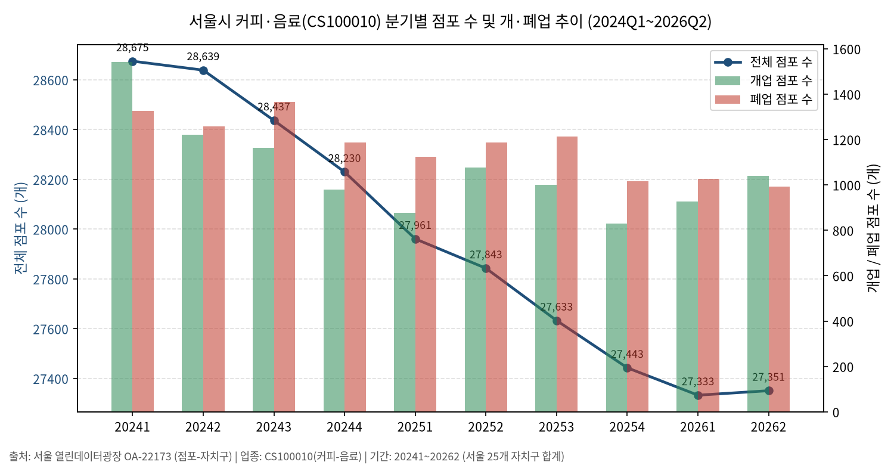
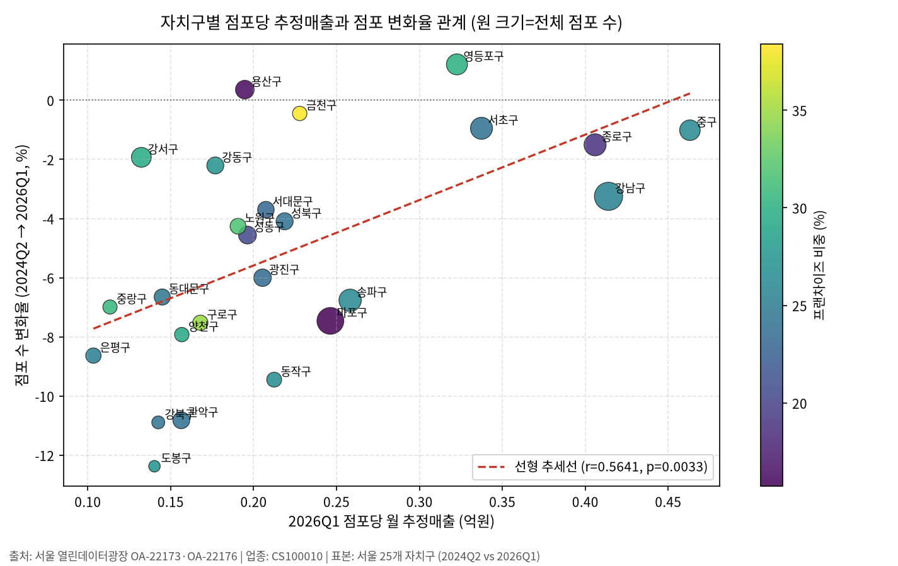
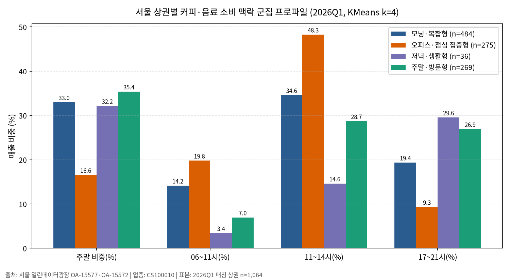

# A. 서울 커피 시장 구조 분석 보고서 (Market Structure Report)

- **분석 대상**: 서울특별시 25개 자치구 및 상권 (`CS100010` 커피-음료)
- **출처**: 서울 열린데이터광장 공식 원본 (`OA-22173`, `OA-22176`, `OA-15577`, `OA-15572`)
- **기준 분기**: `20261` (비교 기간: `20242`~`20261`, 최신 `20262` 병기)

## 1. 서울 전체 시장 추이 (Observed)
- `20242` 기준 **28,639개**였던 서울 커피·음료 점포는 `20261` 기준 **27,333개**로 감소(-1,306개, -4.56%)했으며, `20262`에는 **27,351개**(+18개)로 소폭 반등했다.
- `20242`→`20261` 기간 동안 25개 자치구 중 **23개 구**에서 점포 수가 감소했다(영등포구·용산구만 순증).
- `20261` 기준 서울 전체 프랜차이즈 비중은 **24.87%**, 월 추정매출 합계는 **689,282,715,962원**이다.

## 2. 자치구별 구조적 격차 및 상관관계 (Observed)
- **점포당 추정매출 vs 점포 변화율**: Pearson $r = 0.5641$ ($p = 0.003312$, 95% CI `[0.2175, 0.7844]`), Spearman $\rho = 0.5792$.
- **프랜차이즈 비중 vs 점포 변화율**: Pearson $r = 0.0145$ ($p = 0.945207$, 95% CI `[-0.3828, 0.4073]`) — 통계적으로 유의한 선형 관계가 관찰되지 않았다.
- **OLS 다중회귀** (`점포_증감률_pct ~ 점포당_추정매출_억원 + 프랜차이즈_비중_pct`): $R^2 = 0.3328$ ($F$-test $p = 0.011672$).

### 점포당 추정매출 상위 5개 자치구 (`20261`)
| 자치구_코드_명   |   전체_점포_수 |   점포_증감률_pct |   점포당_추정매출_억원 |   프랜차이즈_비중_pct |
|:-----------|----------:|-------------:|--------------:|---------------:|
| 중구         |      1367 |       -1.014 |        0.4631 |          26.41 |
| 강남구        |      2561 |       -3.249 |        0.414  |          25.38 |
| 종로구        |      1567 |       -1.508 |        0.4059 |          18.76 |
| 서초구        |      1565 |       -0.949 |        0.3374 |          23.83 |
| 영등포구       |      1421 |        1.211 |        0.3226 |          30.05 |

### 점포당 추정매출 하위 5개 자치구 (`20261`)
| 자치구_코드_명   |   전체_점포_수 |   점포_증감률_pct |   점포당_추정매출_억원 |   프랜차이즈_비중_pct |
|:-----------|----------:|-------------:|--------------:|---------------:|
| 강북구        |       540 |      -10.891 |        0.1425 |          24.07 |
| 도봉구        |       432 |      -12.373 |        0.1402 |          27.31 |
| 강서구        |      1270 |       -1.931 |        0.1323 |          29.37 |
| 중랑구        |       652 |       -6.99  |        0.1134 |          30.83 |
| 은평구        |       762 |       -8.633 |        0.1034 |          25.2  |

## 3. 상권 소비 맥락 군집 (`20261`, 매칭 상권 n=1,064)
| cluster_label   |   commercial_area_count |   주말_비중_pct |   시간_06~11_pct |   시간_11~14_pct |   시간_17~21_pct |    점포당_매출_원 |
|:----------------|------------------------:|------------:|---------------:|---------------:|---------------:|------------:|
| 모닝·복합형          |                     484 |       32.98 |          14.16 |          34.62 |          19.38 | 1.94284e+07 |
| 오피스·점심 집중형      |                     275 |       16.57 |          19.8  |          48.28 |           9.34 | 2.2832e+07  |
| 저녁·생활형          |                      36 |       32.16 |           3.43 |          14.64 |          29.58 | 8.77647e+06 |
| 주말·방문형          |                     269 |       35.42 |           6.96 |          28.72 |          26.94 | 2.19676e+07 |

