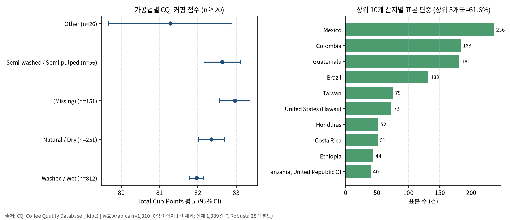

# B. CQI 커피 품질 데이터 전수 분석 보고서 (CQI Quality Report)

- **출처**: `jldbc/coffee-quality-database` (`arabica_data_cleaned.csv` 1,311건 + `robusta_data_cleaned.csv` 28건 = **총 1,339건**)
- **전수 검증**: 중복 0건, `Total.Cup.Points <= 0` 이상치 **1건** 제외 후 유효 Arabica **n=1,310** 기준 품질 비교 수행.

## 1. 표본 편중 및 한계 (Observed)
- 상위 5개 산지(Mexico, Colombia, Guatemala, Brazil, Taiwan)가 전체 Arabica 표본의 **61.62%**를 차지한다.
- CQI 데이터는 국제 커핑 평가 점수이며, **서울 소비자의 향미 선호도나 국내 유통 원두의 품질을 직접 대표하지 않는다.**

## 2. 가공법별 비교 및 통제 회귀 (Observed)
- **단순 비교**: `Natural / Dry` (n=251, 평균 82.3541점) vs `Washed / Wet` (n=812, 평균 81.9646점) → 원차이 **+0.3895점** (Welch $t=1.9723$, $p=0.049247$).
- **산지 통제 OLS (`Country.of.Origin`)**: Natural 효과 **+0.2657점** ($p=0.258517$, 95% CI `[-0.1955, 0.7269]`).
- **산지 + 수확연도 통제 OLS (n=1058)**: Natural 효과 **+0.2573점** ($p=0.278225$).
- **해석**: 산지와 수확시기를 통제하면 Natural과 Washed 간 커핑 점수 차이는 통계적으로 유의하지 않다. 따라서 가공법 자체를 품질 우열의 근거로 일반화할 수 없다.

### 주요 가공법별 요약
| Processing.Method         |   count |   share_pct |   mean_cup_points |   std_cup_points |   ci95_low |   ci95_high |
|:--------------------------|--------:|------------:|------------------:|-----------------:|-----------:|------------:|
| Washed / Wet              |     812 |       61.98 |           81.9646 |           2.6847 |    81.7797 |     82.1496 |
| Natural / Dry             |     251 |       19.16 |           82.3541 |           2.7499 |    82.0123 |     82.696  |
| (Missing)                 |     151 |       11.53 |           82.9655 |           2.4808 |    82.5666 |     83.3644 |
| Semi-washed / Semi-pulped |      56 |        4.27 |           82.6336 |           1.7667 |    82.1604 |     83.1067 |
| Other                     |      26 |        1.98 |           81.2785 |           3.9983 |    79.6635 |     82.8934 |
| Pulped natural / honey    |      14 |        1.07 |           82.8079 |           1.6872 |    81.8337 |     83.782  |

