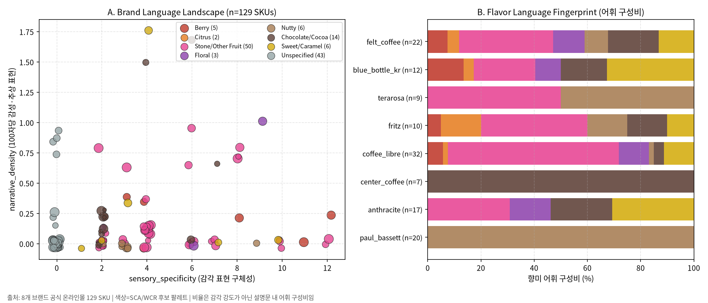

# Coffee Flavor Language Map — 브랜드 향미 언어 구조 및 시각화 문법 보고서

## 1. 핵심 연구 질문 및 3계층 분리 원칙
> **핵심 질문**: *"브랜드별 원두 설명에 나타나는 향미 언어의 차이는 무엇이며, 이를 일관된 시각적 문법으로 변환할 수 있는가?"*

본 연구는 다음 세 계층을 엄격히 분리한다.
1. **데이터에서 관찰되는 관계 (Observed)**: 8개 브랜드 공식 온라인몰 **129개 원두 SKU** 설명문에서 실제 어휘가 얼마나 자주 등장하고 공출현하는가?
2. **해석적 분류 체계 (Analytical Taxonomy)**: SCA/WCR Sensory Lexicon 위계에 따라 어휘를 향미 계열(`flavor_family`), 감각 구체성(`sensory_specificity`), 서사 밀도(`narrative_density`)로 독립 코딩한다.
3. **시각 디자인 대응 규칙 (Visual Encoding)**: 분류된 변수를 색상(Hue)·좌표(X, Y)·크기(Size)에 대응시키며, 이 대응의 인지적 타당성은 별도 매칭 실험으로 검증한다.

- **배경 데이터 경계**: 서울시 상권 데이터 및 CQI(1,339건)는 연구 배경·참조 자료로만 유지하며, 개별 브랜드 SKU의 품질·매출 변수로 억지 결합하지 않는다.

---

## 2. Relationship 01 — 브랜드 × 향미 언어 분석 결과 (Observed & Statistical)

### A. 향미 계열 분포 및 브랜드 간 차이
- **구체성 수준 분포**: 전체 129개 SKU 중 `Specific-Anchored` **75개**, `Broad-Only` **11개**, `None-Stated` **43개**.
- **브랜드 × 대표 향미 계열 독립성 검정**: $\chi^2 = 175.253$ ($df = 49$, $p = 0.0$), **Cramér's $V = 0.4405$** → 브랜드에 따라 강조하는 향미 언어 구성이 중간~강한 수준으로 유의하게 다르다.

### B. 감성 서사 밀도(`narrative_density`)와 감각 구체성(`sensory_specificity`)의 관계
- **단순 상관**: Pearson $r = 0.1671$ ($p = 0.05834$), Spearman $\rho = 0.2348$ ($p = 0.007387$).
- **텍스트 길이 및 싱글오리진 여부 통제 OLS** ($R^2 = 0.1796$):
  - `narrative_density` 계수 = `0.9982` ($p = 0.199814$) — **통계적으로 유의하지 않음**.
  - `is_single_origin` 계수 = **`+3.4712`** ($p = 5e-06$) — 감각 구체성을 결정하는 핵심 요인은 감성 서사 유무가 아니라 **싱글오리진 여부**다.
- **결론**: 감성 서사를 많이 쓴다고 해서 구체적 향미 정보가 줄어드는 배타적 관계는 관찰되지 않았다. 두 차원은 독립적으로 설계 가능하다.

### 브랜드별 언어 프로파일 요약
| brand_id       | brand_segment       |   sku_count |   median_price_per_100g |   mean_sensory_specificity |   mean_narrative_density |   pct_specific_anchored |
|:---------------|:--------------------|------------:|------------------------:|---------------------------:|-------------------------:|------------------------:|
| felt_coffee    | Specialty Roaster   |          22 |                   13250 |                       5.36 |                    0.094 |                    90.9 |
| blue_bottle_kr | Global Specialty    |          12 |                   12875 |                       5.33 |                    0.726 |                    66.7 |
| terarosa       | Specialty Roaster   |           9 |                   17200 |                       4    |                    0.116 |                   100   |
| fritz          | Specialty Roaster   |          10 |                    9000 |                       3.5  |                    0.293 |                    70   |
| coffee_libre   | Specialty Roaster   |          32 |                    9500 |                       3.06 |                    0     |                    59.4 |
| center_coffee  | Specialty Roaster   |           7 |                   12381 |                       2    |                    0.207 |                   100   |
| anthracite     | Specialty Roaster   |          17 |                    8750 |                       1.06 |                    0.056 |                    29.4 |
| paul_bassett   | Franchise Reference |          20 |                     nan |                       0.3  |                    0.173 |                     0   |

---

## 3. Relationship 02 — 시각화 문법 및 핵심 시각화 2종

| 데이터 파라미터 | 측정 대상 | 시각적 표현 |
|---|---|---|
| `flavor_family` | SCA/WCR 위계 기반 대표 향미 계열 | 색상 (Hue, 후보 팔레트) |
| `term_share` / `sku_pct` | 계열별 어휘 구성비 vs SKU 언급률 | Fingerprint 막대 길이 |
| `sensory_specificity` | 광의(1)·구체적 앵커(2) 가중 합산 | X축 위치 |
| `narrative_density` | 100자당 감성·추상 표현 빈도 | Y축 위치 |
| `brand_id` | 판매 브랜드 | 인터랙티브 하이라이트 필터 |
| `price_per_100g` | 100g 환산 가격 | 점 크기 (결측 시 기본 크기) |

- **Visualization A — Brand Language Landscape**: 129개 SKU 개별 언어 좌표 맵 ([`coffee_flavor_language_map.html`](file:///home/antigravity/CHO-YOUN-SIK/CoffeeGraph/outputs/figures/coffee_flavor_language_map.html))
- **Visualization B — Flavor Language Fingerprint**: 브랜드별 어휘 구성비 비교 (감각 강도가 아닌 **설명문 내 표현 구성비**로 해석)

---

## 4. 후속 디자인 검증 프로토콜 (색–향미 매칭 실험)
시각화 인코딩(Layer 3)의 타당성을 검증하기 위해 한국 소비자를 대상으로 **색–향미 교차감각 매칭 실험**을 제안한다.
- **실험 과제**: 7개 향미 계열 후보 색상(Berry `#C0392B`, Citrus `#E67E22`, Stone Fruit `#E84393`, Floral `#8E44AD`, Nutty `#A67C52`, Chocolate `#5D4037`, Sweet/Caramel `#D4AC0D`)과 한국어 향미 앵커 간 매칭 일치율(Accuracy) 및 반응시간(RT) 측정.
- **평가 기준**: 무작위 기대 일치율(14.3%) 대비 유의한 초과 일치율 및 문화적 혼동 쌍(예: Berry vs Citrus, Nutty vs Chocolate) 식별 후 팔레트 보정.
